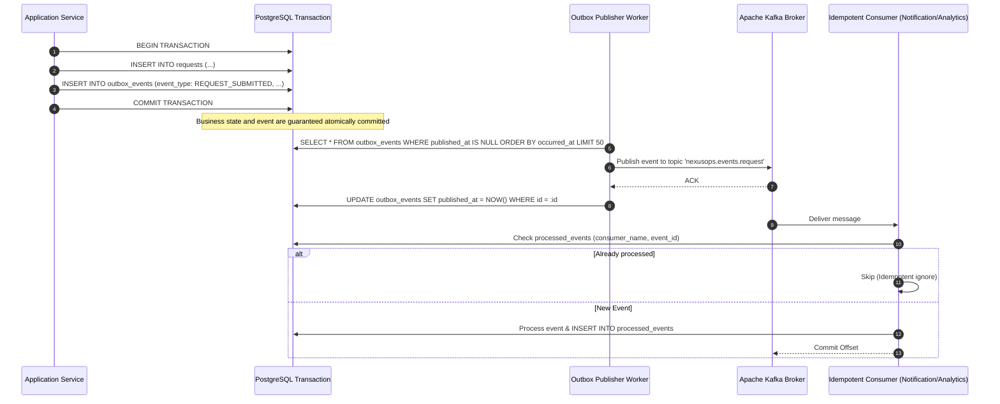

# NexusOps – Asynchronous Event Catalogue & Outbox Architecture

**Document Version:** 1.0.0  
**Status:** Approved for Architecture & Design  
**Author:** NexusOps Architecture Team  

---

## 1. Asynchronous Architecture & The Transactional Outbox Pattern

NexusOps uses **Apache Kafka** exclusively where asynchronous execution improves responsiveness and reliability:
- Notification fan-out (in-app alerts, emails via Mailpit)
- Audit log indexing
- Analytics aggregation counters
- Heavy document text extraction & vector embedding generation
- SLA monitoring & timeout triggers

Synchronous in-transaction operations:
- Request creation & validation
- Workflow node progression
- Approval decision recording
- Task state updates



> [!IMPORTANT]
> **Resilience Guarantee:** If Apache Kafka is temporarily unreachable or crashes, the user's request submission or approval action still succeeds completely. The event remains queued in `outbox_events` and will be relayed automatically once Kafka recovers.

---

## 2. Standardized Event Envelope Schema

All events published to Kafka adhere to an immutable JSON envelope schema:

```json
{
  "eventId": "9b1deb4d-3b7d-4bad-9bdd-2b0d7b3dcb6d",
  "eventType": "REQUEST_SUBMITTED",
  "eventVersion": 1,
  "organizationId": "3fa85f64-5717-4562-b3fc-2c963f66afa6",
  "aggregateId": "7c9e6679-7425-40de-944b-e07fc1f90ae7",
  "aggregateType": "REQUEST",
  "correlationId": "c0a80123-4567-89ab-cdef-0123456789ab",
  "occurredAt": "2026-11-09T05:50:00.123Z",
  "payload": {
    "requestNumber": "REQ-1001",
    "categoryId": "11111111-2222-3333-4444-555555555555",
    "requesterMembershipId": "aaaaaaaa-bbbb-cccc-dddd-eeeeeeeeeeee",
    "title": "MacBook Pro 16 M3 Max",
    "priority": "HIGH"
  }
}
```

---

## 3. Official Event Catalogue

| Event Type | Kafka Topic | Triggering Action | Key Consumers |
| :--- | :--- | :--- | :--- |
| `REQUEST_SUBMITTED` | `nexusops.events.request` | Employee submits request. | Notifications (email requester), Analytics (increment counter), Audit. |
| `REQUEST_CANCELLED` | `nexusops.events.request` | Requester or admin cancels request. | Workflow Engine (cancel active instance), Notifications, Audit. |
| `APPROVAL_CREATED` | `nexusops.events.approval` | Workflow advances to an `APPROVAL` node. | Notification (alert designated approvers via email/in-app), SLA Scheduler. |
| `APPROVAL_COMPLETED` | `nexusops.events.approval` | Approver approves or delegates. | Workflow Engine (advance to next node), Notifications, Audit. |
| `APPROVAL_REJECTED` | `nexusops.events.approval` | Approver rejects request. | Workflow Engine (terminate instance), Notifications (alert requester), Audit. |
| `TASK_CREATED` | `nexusops.events.task` | Workflow advances to a `TASK` node. | Notification (alert queue operators), SLA Scheduler. |
| `TASK_ASSIGNED` | `nexusops.events.task` | Operator claims or reassigns task. | Notification (alert new assignee), Audit. |
| `TASK_COMPLETED` | `nexusops.events.task` | Operator finishes fulfillment. | Workflow Engine (advance graph / complete request), Notifications, Audit. |
| `DOCUMENT_UPLOADED` | `nexusops.events.knowledge`| Admin uploads policy file to MinIO. | Text Extraction & Embedding Worker (Tika/PDFBox + pgvector). |
| `DOCUMENT_INDEXED` | `nexusops.events.knowledge`| Text chunking and embedding finishes. | Notification, AI Cache Invalidation. |
| `SLA_BREACHED` | `nexusops.events.sla` | Approval or task deadline passes. | Notification (escalate to manager), Analytics (SLA breach metrics). |
| `WORKFLOW_COMPLETED`| `nexusops.events.workflow` | Final `END` node reached. | Notification (inform employee of fulfillment), Analytics (cycle time). |

---

## 4. Idempotency & Dead-Letter Topic (DLT) Strategy

### 4.1 Consumer Idempotency Registry
Consumers track processed messages in the database:
```sql
CREATE TABLE processed_events (
    id UUID PRIMARY KEY DEFAULT gen_random_uuid(),
    consumer_name VARCHAR(100) NOT NULL,
    event_id UUID NOT NULL,
    processed_at TIMESTAMPTZ NOT NULL DEFAULT clock_timestamp(),
    CONSTRAINT uq_consumer_event UNIQUE (consumer_name, event_id)
);
```
Before executing side-effects, the consumer performs an atomic insert. A primary key / unique violation indicates the event was already consumed, and the message is safely acknowledged without duplicate side-effects.

### 4.2 Error Handling, Backoff & Dead-Letter Topics (DLT)
1. **Transient Errors (e.g. database lock timeout, temporary SMTP glitch):** Retried 3 times with exponential backoff (1s, 2s, 4s).
2. **Permanent Failures (poison pill, deserialization crash, data corruption):** Routed automatically to the Dead-Letter Topic: `nexusops.<topic>.DLT`.
3. An operational alert is emitted to the admin dashboard, allowing inspection and replaying from the DLT after the root cause is resolved.
