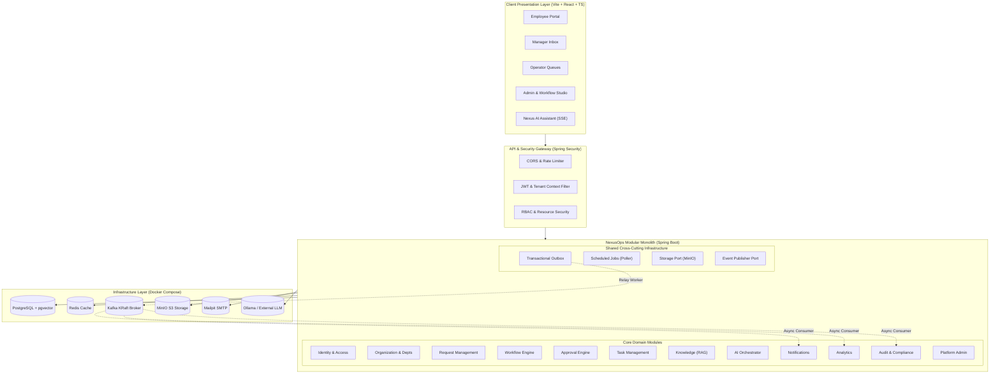
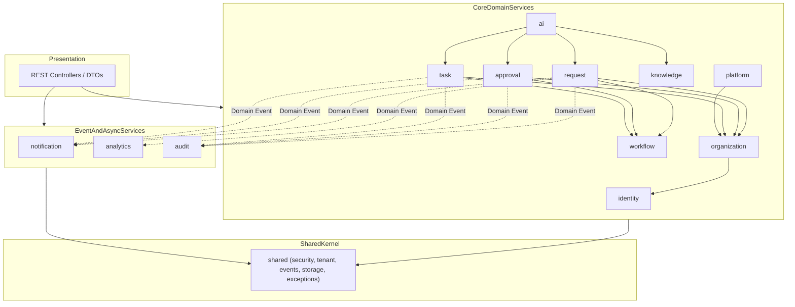

# NexusOps – System Architecture & Module Boundaries

**Document Version:** 1.0.0  
**Status:** Approved for Architecture & Design  
**Author:** NexusOps Architecture Team  

---

## 1. Architectural Philosophy: The Governed Modular Monolith

NexusOps is built as a **modular monolith** with event-driven internal processing using **Spring Boot 3.3.x / Java 21 LTS** and **React 18 / TypeScript**.

### Why Not Microservices?
- Avoids distributed transaction overhead (no two-phase commits or saga orchestration failures across network boundaries).
- Local-first development: Runs comfortably on a single laptop in Docker Compose without requiring a distributed service mesh (Kubernetes, Consul, Istio).
- Eliminates network latency between business modules while preserving strict logical separation.
- Future-proof: Strict module boundaries enforced by **Spring Modulith** allow any module (e.g., AI Orchestration or Workflow Engine) to be extracted into an independent microservice later if traffic patterns demand it.

---

## 2. High-Level System Architecture Diagram



---

## 3. Module Boundaries & Dependency Governance

To maintain a clean modular architecture, NexusOps enforces strict coupling rules verified at compile/test time using **Spring Modulith**.

### The 12 Business Modules + Shared Kernel

| Module Package | Primary Responsibility | Direct Dependencies Allowed |
| :--- | :--- | :--- |
| `com.nexusops.identity` | Global users, memberships, JWT tokens, RBAC roles, permissions. | `shared` |
| `com.nexusops.organization` | Organizations, departments, teams, employee directory, hierarchy. | `identity`, `shared` |
| `com.nexusops.request` | Request intake, category schemas, draft/submit lifecycles, comments. | `organization`, `identity`, `shared` |
| `com.nexusops.workflow` | Workflow definitions, versioning, node handlers, execution graph, transitions. | `shared` |
| `com.nexusops.approval` | Approval instances, multi-stage approval logic, decision history. | `workflow`, `organization`, `identity`, `shared` |
| `com.nexusops.task` | Fulfillment tasks, department queues, assignments, completion. | `workflow`, `organization`, `identity`, `shared` |
| `com.nexusops.knowledge` | Document upload, text extraction, chunking, pgvector indexing, search. | `shared` |
| `com.nexusops.ai` | Natural language chat, intent classification, RAG retrieval, tool calling registry. | `request`, `approval`, `task`, `knowledge`, `shared` |
| `com.nexusops.notification` | In-app alerts, email generation via Mailpit, preference settings. | `shared` |
| `com.nexusops.analytics` | Aggregated metrics, operational KPIs, SLA breach analysis. | `shared` |
| `com.nexusops.audit` | Append-only audit logging, before/after diffs, correlation ID tracking. | `shared` |
| `com.nexusops.platform` | System-wide tenant provisioning, platform settings, maintenance. | `identity`, `organization`, `shared` |
| `com.nexusops.shared` | Tenant context, security utils, outbox, exception models, base DTOs. | *(No business module dependencies)* |

### Strict Boundary Rules
1. **No Cross-Module Database Access:** Module A must **never** reference repositories, JPA entities, or database tables owned by Module B.
2. **Explicit Application Interfaces:** When Module A needs data or actions from Module B, it calls Module B's public application service interface (e.g., `WorkflowExecutionService`, `TaskCommandService`).
3. **Decoupled Asynchronous Events:** Cross-cutting concerns (notifications, audit logs, analytics aggregates) communicate strictly via asynchronous domain events emitted through the Transactional Outbox.
4. **DTO Encapsulation:** JPA entities are never exposed across module boundaries or in REST controllers. All inputs and outputs are immutable DTOs (Java records).
5. **Architectural Verification:** The backend includes a dedicated unit test:
   ```java
   @Test
   void verifyModularArchitecture() {
       ApplicationModules.of(NexusOpsApplication.class).verify();
   }
   ```

---

## 4. Module Dependency Graph (Directed Acyclic Graph)



---

## 5. Technology Stack & Version Matrix

| Layer / Component | Technology | Version | Justification |
| :--- | :--- | :--- | :--- |
| **Runtime** | Java LTS | 21 (or 25 LTS) | Modern virtual threads (Project Loom), pattern matching, record classes, long-term support. |
| **Framework** | Spring Boot | 3.3.5 | Latest stable release with official Spring AI 1.0.0-M3 / M4 support and mature Spring Modulith integration. |
| **Architecture Guard** | Spring Modulith | 1.2.4 | Enforces module encapsulation and verifies acyclic dependencies. |
| **Database** | PostgreSQL + pgvector | 16-pgvector | Rock-solid ACID persistence, native JSONB support, integrated HNSW vector indexing. |
| **Migration** | Flyway | 10.15.x | Deterministic, version-controlled schema evolution; eliminates Hibernate auto-DDL risks. |
| **Caching** | Redis | 7.2 | Fast in-memory caching for tenant metadata, rate-limiting counters, and session tokens. |
| **Messaging** | Apache Kafka | 3.8.0 (KRaft) | Modern KRaft mode (no ZooKeeper dependency), high-throughput transactional outbox relay. |
| **Object Storage** | MinIO | Latest (RELEASE.2024+) | Local AWS S3-compatible API for policy documents and request attachments. |
| **Local SMTP** | Mailpit | v1.18+ | Built-in web UI on port 8025 for instant visual verification of outgoing emails. |
| **Frontend Framework** | React + TypeScript | 18.3.x / TS 5.5 | Industry standard for enterprise SPAs, type-safe development. |
| **Build Tool (FE)** | Vite | 5.4.x | Sub-second HMR and optimized production bundles. |
| **Styling** | Tailwind CSS | 3.4.x | Utility-first CSS, rapid UI development with consistent enterprise tokens. |
| **Workflow Designer** | React Flow | 11.11.x | Robust visual canvas for node-based graph editing with customizable nodes/edges. |
| **State & Data Fetching**| TanStack Query v5 + Zustand | 5.59.x / 4.5.x | Server state caching, optimistic updates, and minimal global state. |

