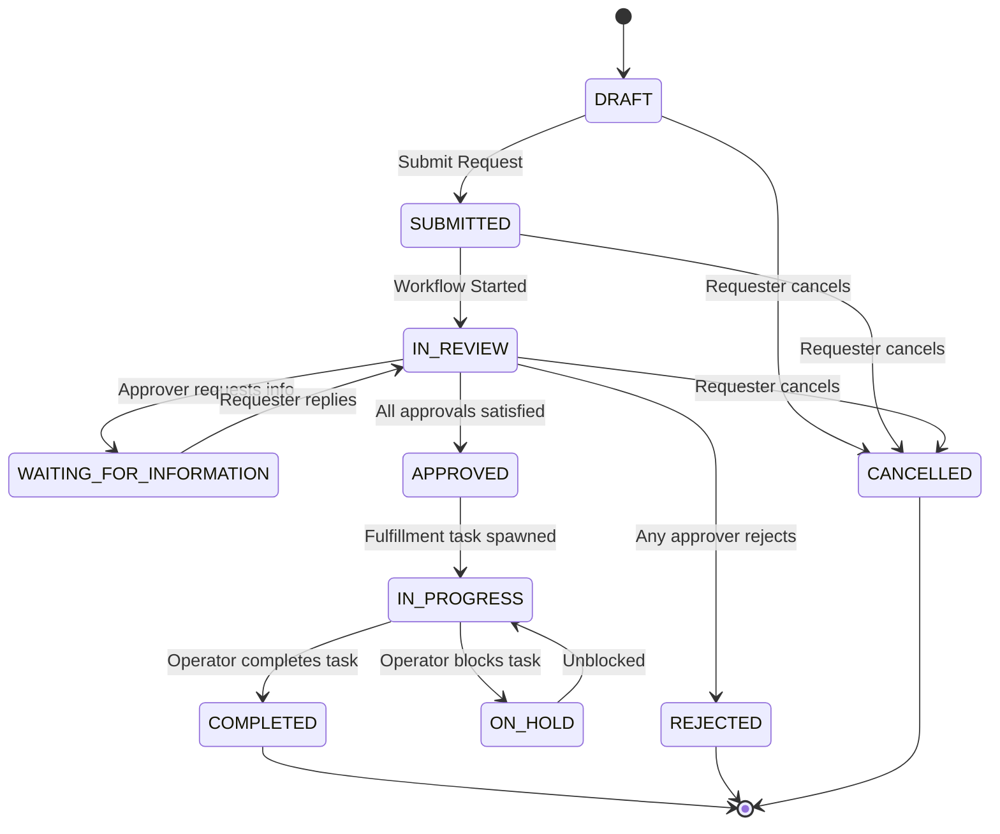
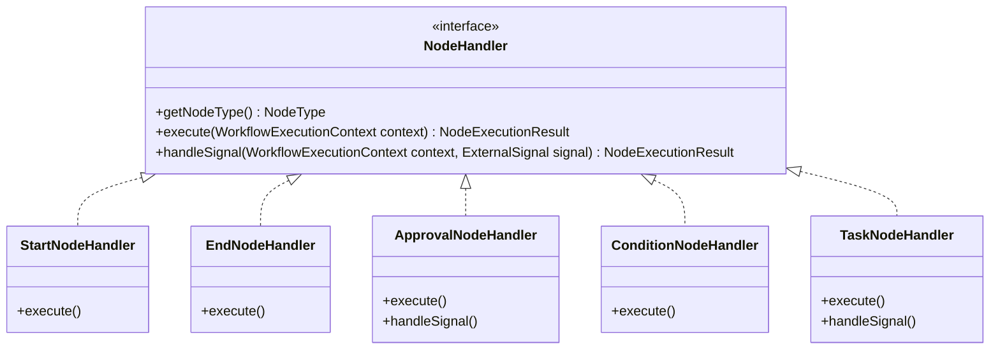
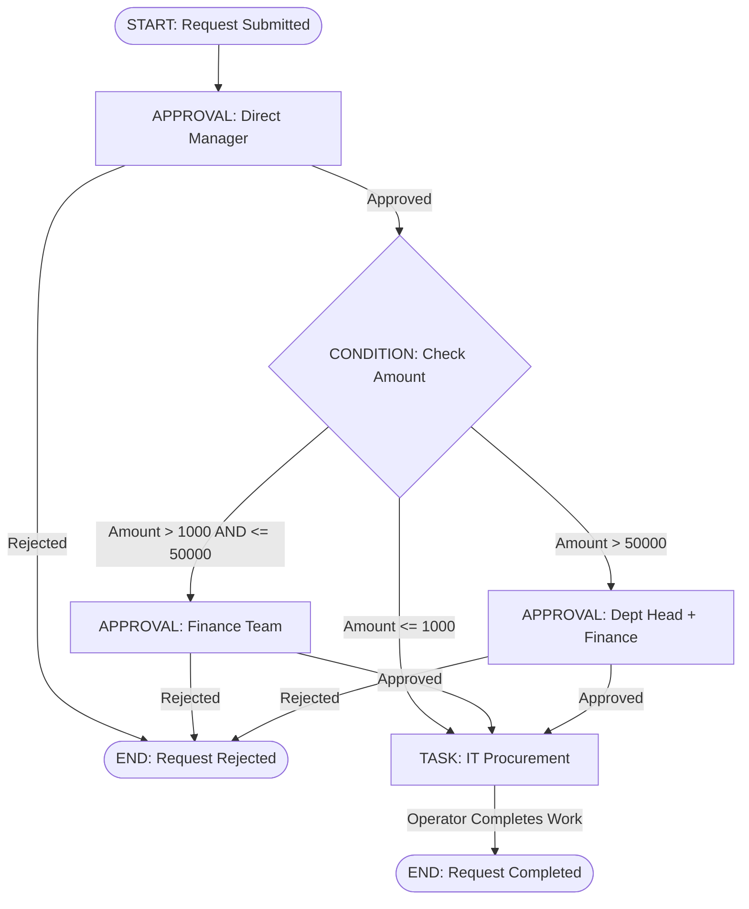

# NexusOps – Workflow Engine Design & Specification

**Document Version:** 1.0.0  
**Status:** Approved for Architecture & Design  
**Author:** NexusOps Architecture Team  

---

## 1. Engine Mission & Architectural Principles

The **Workflow Engine** is the core orchestration heart of NexusOps. It executes business processes defined visually by administrators without requiring backend code deployments or restarts.

### Inviolable Principles
1. **Durable, Asynchronous Execution:** No Java thread ever blocks or waits in memory for a human decision. State transitions are persisted immediately in PostgreSQL. The system can be restarted at any second without losing in-flight workflow state.
2. **Version Immutability:** When a workflow is published, its version (`WorkflowVersion`) is locked permanently. In-flight workflow instances execute to completion against the version they were initiated with. Editing a workflow creates a new draft version.
3. **Safe, Typed Condition Evaluation:** Business rules (e.g., amount thresholds) are evaluated using a strict, typed JSON predicate engine. **Never** use SpEL (Spring Expression Language), JavaScript, Groovy, SQL, or arbitrary script eval.
4. **Idempotent Transitions:** Duplicate events or retries must never create duplicate approvals or tasks.
5. **Timeout Never Auto-Approves:** Expired SLAs or deadlines trigger reminders, escalations to superiors, or formal cancellations. A timeout **never** results in automatic approval.

---

## 2. Complete State Machines



### Detailed State Lifecycles

| State Machine | States | Transition Triggers | Terminal States |
| :--- | :--- | :--- | :--- |
| **Request** | `DRAFT`, `SUBMITTED`, `IN_REVIEW`, `WAITING_FOR_INFORMATION`, `APPROVED`, `IN_PROGRESS`, `ON_HOLD`, `COMPLETED`, `REJECTED`, `CANCELLED` | User submission, approval decisions, clarification replies, task claiming, task completion. | `COMPLETED`, `REJECTED`, `CANCELLED` |
| **Workflow Instance**| `CREATED`, `RUNNING`, `WAITING`, `SUSPENDED`, `COMPLETED`, `REJECTED`, `CANCELLED`, `FAILED` | Instance start, node entry/exit, human approval wait, task completion, rejection signal. | `COMPLETED`, `REJECTED`, `CANCELLED`, `FAILED` |
| **Node Instance** | `PENDING`, `READY`, `RUNNING`, `WAITING`, `COMPLETED`, `FAILED`, `SKIPPED`, `CANCELLED` | Workflow advancement, external event delivery (approval action, task finished). | `COMPLETED`, `FAILED`, `SKIPPED`, `CANCELLED` |
| **Approval** | `PENDING`, `APPROVED`, `REJECTED`, `REQUESTED_INFO`, `EXPIRED`, `CANCELLED` | Actor decision (`APPROVE`, `REJECT`, `REQUEST_INFORMATION`), deadline timeout. | `APPROVED`, `REJECTED`, `EXPIRED`, `CANCELLED` |
| **Task** | `OPEN`, `IN_PROGRESS`, `BLOCKED`, `COMPLETED`, `CANCELLED` | Operator claim, operator completion, upstream cancellation. | `COMPLETED`, `CANCELLED` |

---

## 3. Node Handler Architecture & Registry

Each node type in the graph is processed by a dedicated Java bean implementing `NodeHandler`.



### Node Handler Registry
```java
@Component
public class NodeHandlerRegistry {
    private final Map<NodeType, NodeHandler> handlers;

    public NodeHandlerRegistry(List<NodeHandler> handlerList) {
        this.handlers = handlerList.stream()
            .collect(Collectors.toMap(NodeHandler::getNodeType, Function.identity()));
    }

    public NodeHandler getHandler(NodeType type) {
        NodeHandler handler = handlers.get(type);
        if (handler == null) {
            throw new UnsupportedNodeException("Unsupported node type: " + type);
        }
        return handler;
    }
}
```

### Node Behaviors (v1 Scope)
1. **`START` Node:** Initial entry point. Validates initial context, marks node `COMPLETED`, and advances immediately to outbound transition.
2. **`CONDITION` Node:** Evaluates outgoing transition predicates sequentially ordered by `priority ASC`. Routes to the first matching edge or falls back to `is_default=true`.
3. **`APPROVAL` Node:** Creates an `approval_instances` record with approver resolution rules (direct manager, specific role, or department head). Transitions node state to `WAITING`. Suspends workflow thread.
4. **`TASK` Node:** Spawns a fulfillment `tasks` record assigned to an operator queue or specific membership. Transitions node state to `WAITING`.
5. **`END` Node:** Marks workflow instance `COMPLETED` and marks the associated request `COMPLETED` (or `REJECTED` if reached via rejection route).

---

## 4. Typed Condition Evaluator (Security-Hardened)

To prevent Remote Code Execution (RCE) and injection vulnerabilities, condition expressions are represented strictly as structured JSON schemas.

### Condition Expression Schema
```json
{
  "field": "payload.estimatedAmount",
  "operator": "GREATER_THAN",
  "value": 50000.00
}
```

### Whitelisted Operators
- Numeric / Currency: `GREATER_THAN`, `GREATER_THAN_OR_EQUAL`, `LESS_THAN`, `LESS_THAN_OR_EQUAL`
- Equality: `EQUALS`, `NOT_EQUALS`
- Collection / Set: `IN`, `CONTAINS`

### Whitelisted Field Paths
- `payload.<fieldName>` (Dynamic form field)
- `request.priority` (Request priority string)
- `requester.departmentCode` (Department of the requester)
- `requester.jobTitle` (Job title of the requester)

### Evaluation Logic
```java
public class TypedConditionEvaluator {
    public boolean evaluate(JsonNode conditionExpr, WorkflowExecutionContext context) {
        if (conditionExpr == null || conditionExpr.isNull() || conditionExpr.isEmpty()) {
            return true; // Unconditional transition
        }
        String fieldPath = conditionExpr.get("field").asText();
        String operator = conditionExpr.get("operator").asText();
        JsonNode targetValue = conditionExpr.get("value");

        Object actualValue = context.resolveField(fieldPath);
        return compare(actualValue, operator, targetValue);
    }
}
```

---

## 5. Reference Workflow Graph: Hardware Purchase



---

## 6. Graph Validation Rules (Enforced at Save & Publish)

Before any `WorkflowVersion` can be published, the backend executes strict graph validation:
1. **Single Entry:** Exactly one node with type `START`.
2. **Reachable Termination:** At least one reachable node with type `END`.
3. **No Dangling Nodes:** Every node (except `END`) must have at least one outgoing transition. Every node (except `START`) must have at least one incoming transition.
4. **Unique Node Keys:** All `node_key` identifiers within the version must be unique.
5. **Deterministic Outgoing Paths:**
   - A `CONDITION` node must have an explicit default route (`is_default = true`) or exhaustively cover conditions to prevent workflow stalling.
   - Transitions from a `CONDITION` node must have distinct, positive `priority` integers.
6. **Cycle Safeguards:** Graphs must not contain infinite non-terminating loops without an intervening human node (`APPROVAL` or `TASK`).

---

## 7. Concurrency & Durability Guarantees

### 7.1 Optimistic Locking & Simultaneous Approvers
When multiple approvers attempt to act on an approval instance concurrently (e.g., in a pooled finance queue):
- Both read `version = 0`.
- Approver A's transaction commits: updates `status = 'APPROVED'` and increments `version = 1`.
- Approver B's transaction attempts to commit with `version = 0`: Hibernate detects `OptimisticLockException`.
- The API intercepts the exception and returns **HTTP 409 Conflict** with:
  ```json
  {
    "success": false,
    "error": {
      "code": "CONCURRENT_MODIFICATION",
      "message": "This approval was already processed by another approver."
    }
  }
  ```

### 7.2 Durable Timers & Escalations (Scheduled Jobs)
Timeouts and SLA tracking run asynchronously via `scheduled_jobs`:
- When an approval is created with SLA deadline `due_at`, a row is created in `scheduled_jobs` with `execute_at = due_at`.
- A background scheduler polls due jobs every 30 seconds:
  ```sql
  SELECT * FROM scheduled_jobs 
  WHERE status = 'PENDING' AND execute_at <= clock_timestamp() 
  ORDER BY execute_at ASC 
  FOR UPDATE SKIP LOCKED 
  LIMIT 50;
  ```
- `FOR UPDATE SKIP LOCKED` guarantees that multiple application nodes will never process the same timeout concurrently.
- Triggered actions:
  - Send email/in-app reminder to approver.
  - Escalate to the approver's manager if configured.
  - Transition status to `EXPIRED` if a hard timeout is reached.
  - **Never auto-approve.**

