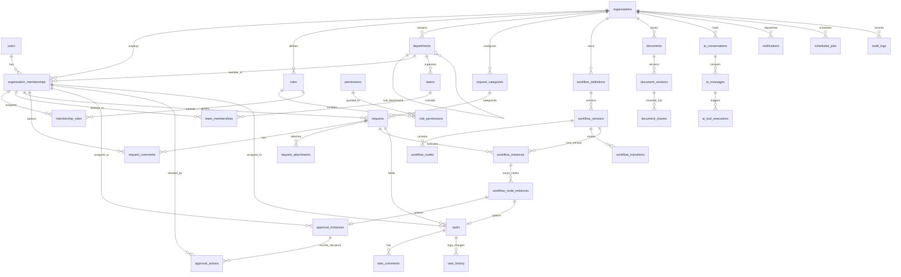

# NexusOps – Database Architecture, ER Diagram & Data Dictionary

**Document Version:** 1.0.0  
**Status:** Approved for Architecture & Design  
**Author:** NexusOps Architecture Team  

---

## 1. Database Philosophy & Architectural Standards

1. **RDBMS Engine:** PostgreSQL 16+ with extensions `pgcrypto` (UUID generation) and `vector` (pgvector for semantic search).
2. **Multi-Tenancy Model:** Shared database, shared schema.
3. **Primary Keys:** `UUID` v4 for every table (generated server-side or via `gen_random_uuid()`).
4. **Human-Readable Identifiers:** In addition to internal UUIDs, business entities maintain tenant-scoped sequence numbers:
   - Requests: `REQ-1001`, `REQ-1002`, etc.
   - Tasks: `TASK-1001`, `TASK-1002`, etc.
   - Workflows: `WF-1001`, etc.
5. **Data Types:**
   - Timestamps: Always `TIMESTAMPTZ` stored in UTC.
   - Monetary Amounts: `NUMERIC(19, 2)` (never floating point).
   - Dynamic Schemas & Flexible Payloads: `JSONB`.
   - Embeddings: `vector(1536)` (OpenAI) or `vector(768)` (Ollama nomic-embed-text / bge-base).
6. **Optimistic Locking:** Managed through a `version BIGINT DEFAULT 0 NOT NULL` column on all mutable entities.
7. **Schema Evolution:** Managed exclusively through **Flyway**. Hibernate DDL-generation is strictly disabled (`spring.jpa.hibernate.ddl-auto=validate`).
8. **Audit Preservation:** Hard deletes are prohibited on transactional business data. Audit tables and action logs are strictly append-only.

---

## 2. Multi-Tenant Defense-in-Depth Architecture

Tenant isolation is implemented and enforced across multiple architectural layers:

```
[Incoming Request]
       │
       ▼
[1. JWT Filter] ────────── Validates JWT and extracts organization_id into Security Context
       │
       ▼
[2. Service Layer] ────── Injects tenant context; rejects cross-tenant references
       │
       ▼
[3. Tenant Composite FKs] ─ Foreign keys enforce same organization_id across relations
       │
       ▼
[4. PostgreSQL RLS] ────── Sets session var 'app.current_tenant_id'; blocks queries failing filter
```

### 2.1 Tenant-Aware Composite Foreign Keys
To guarantee that a record in Organization A never points to a parent or associated record in Organization B, all tenant-owned child tables reference a **composite unique key `(organization_id, id)`** on the parent table.

```sql
-- Parent Table Unique Constraint
ALTER TABLE organization_memberships 
ADD CONSTRAINT uq_memberships_org_id UNIQUE (organization_id, id);

-- Child Table Composite Foreign Key Reference
ALTER TABLE requests 
ADD CONSTRAINT fk_requests_requester 
FOREIGN KEY (organization_id, requester_membership_id) 
REFERENCES organization_memberships (organization_id, id);
```
*Effect:* If an attacker attempts to inject a `requester_membership_id` belonging to Tenant B into a request created under Tenant A, the PostgreSQL database engine aborts the transaction immediately with a foreign key violation.

### 2.2 PostgreSQL Row-Level Security (RLS)
As a second layer of defense, RLS policies are enabled on all tenant-owned tables:
```sql
ALTER TABLE requests ENABLE ROW LEVEL SECURITY;

CREATE POLICY tenant_isolation_policy ON requests
    AS RESTRICTIVE
    USING (organization_id = NULLIF(current_setting('app.current_tenant_id', true), '')::uuid);
```
At the start of each database transaction, the Spring Boot connection provider sets:
`SET LOCAL app.current_tenant_id = '<current-user-org-uuid>';`

---

## 3. Complete Entity Relationship Diagram (Mermaid)



---

## 4. Comprehensive Data Dictionary

### Group A: Identity & Access Management

#### 4.1 `users` (Global Person Identity)
Stores user credentials and global profile. A single user can belong to multiple organizations.
| Column | Data Type | Constraints | Description |
| :--- | :--- | :--- | :--- |
| `id` | UUID | PK, DEFAULT `gen_random_uuid()` | Unique user identifier. |
| `email` | VARCHAR(255) | NOT NULL, UNIQUE | Normalized lowercase email address. |
| `password_hash` | VARCHAR(255) | NOT NULL | BCrypt / Argon2 password hash. |
| `first_name` | VARCHAR(100) | NOT NULL | Given name. |
| `last_name` | VARCHAR(100) | NOT NULL | Family name. |
| `status` | VARCHAR(30) | NOT NULL | `ACTIVE`, `INVITED`, `SUSPENDED`, `DEACTIVATED`. |
| `email_verified` | BOOLEAN | NOT NULL, DEFAULT FALSE | Whether email verification was completed. |
| `created_at` | TIMESTAMPTZ | NOT NULL, DEFAULT clock_timestamp() | Record creation timestamp (UTC). |
| `updated_at` | TIMESTAMPTZ | NOT NULL, DEFAULT clock_timestamp() | Last modification timestamp (UTC). |

#### 4.2 `organizations` (Tenant Account)
| Column | Data Type | Constraints | Description |
| :--- | :--- | :--- | :--- |
| `id` | UUID | PK, DEFAULT `gen_random_uuid()` | Unique tenant identifier. |
| `name` | VARCHAR(255) | NOT NULL | Legal or commercial company name. |
| `slug` | VARCHAR(100) | NOT NULL, UNIQUE | Tenant URL slug (e.g. `acme-corp`). |
| `status` | VARCHAR(30) | NOT NULL | `ACTIVE`, `SUSPENDED`, `TRIAL`. |
| `created_at` | TIMESTAMPTZ | NOT NULL, DEFAULT clock_timestamp() | Tenant registration timestamp. |
| `updated_at` | TIMESTAMPTZ | NOT NULL, DEFAULT clock_timestamp() | Last modification timestamp. |

#### 4.3 `organization_memberships` (User ↔ Organization Link)
| Column | Data Type | Constraints | Description |
| :--- | :--- | :--- | :--- |
| `id` | UUID | PK, DEFAULT `gen_random_uuid()` | Unique membership identifier. |
| `organization_id` | UUID | NOT NULL, FK → `organizations(id)` | Tenant identifier. |
| `user_id` | UUID | NOT NULL, FK → `users(id)` | Associated global user. |
| `department_id` | UUID | NULLABLE, FK → `departments(id)` | Assigned primary department. |
| `manager_membership_id`| UUID | NULLABLE, FK → `organization_memberships(id)`| Direct manager within the company. |
| `job_title` | VARCHAR(150) | NULLABLE | Professional title (e.g. "Staff Engineer"). |
| `status` | VARCHAR(30) | NOT NULL | `ACTIVE`, `INVITED`, `INACTIVE`. |
| `created_at` | TIMESTAMPTZ | NOT NULL, DEFAULT clock_timestamp() | Membership established timestamp. |
| *Composite Unique* | `(organization_id, id)` | UNIQUE | Required for tenant-aware composite FKs. |
| *Composite Unique* | `(organization_id, user_id)`| UNIQUE | Prevents duplicate memberships in same tenant. |

#### 4.4 `roles` (Tenant-Scoped Roles)
| Column | Data Type | Constraints | Description |
| :--- | :--- | :--- | :--- |
| `id` | UUID | PK, DEFAULT `gen_random_uuid()` | Unique role ID. |
| `organization_id` | UUID | NOT NULL, FK → `organizations(id)` | Tenant identifier. |
| `code` | VARCHAR(50) | NOT NULL | Role code (e.g., `ORG_ADMIN`, `MANAGER`, `OPERATOR`). |
| `name` | VARCHAR(100) | NOT NULL | Display name. |
| `is_system_role` | BOOLEAN | NOT NULL, DEFAULT FALSE | System roles cannot be modified or deleted. |
| *Composite Unique* | `(organization_id, code)` | UNIQUE | Unique role code per organization. |

#### 4.5 `permissions` (Global Permission Registry)
| Column | Data Type | Constraints | Description |
| :--- | :--- | :--- | :--- |
| `id` | UUID | PK, DEFAULT `gen_random_uuid()` | Unique permission ID. |
| `code` | VARCHAR(100) | NOT NULL, UNIQUE | Permission code (e.g., `REQUEST_CREATE`, `APPROVAL_EXECUTE`). |
| `category` | VARCHAR(50) | NOT NULL | Grouping (e.g. `REQUEST`, `WORKFLOW`, `ADMIN`). |
| `description` | VARCHAR(255) | NOT NULL | Human-readable description. |

#### 4.6 `membership_roles` & `role_permissions`
Cross-reference join tables connecting memberships to roles, and roles to permissions.

---

### Group B: Organization Hierarchy

#### 4.7 `departments`
| Column | Data Type | Constraints | Description |
| :--- | :--- | :--- | :--- |
| `id` | UUID | PK, DEFAULT `gen_random_uuid()` | Department ID. |
| `organization_id` | UUID | NOT NULL, FK → `organizations(id)` | Tenant identifier. |
| `code` | VARCHAR(50) | NOT NULL | Department code (e.g., `ENG`, `FIN`, `HR`). |
| `name` | VARCHAR(100) | NOT NULL | Display name. |
| `parent_department_id`| UUID | NULLABLE, FK → `departments(id)` | Hierarchical parent department. |
| `head_membership_id` | UUID | NULLABLE, FK → `organization_memberships(id)`| Designated department head. |
| *Composite Unique* | `(organization_id, code)` | UNIQUE | Department code unique within tenant. |

#### 4.8 `teams` & `team_memberships`
Allows grouping operators into functional queues (e.g., `IT_PROCUREMENT_TEAM`, `FINANCE_PAYROLL`).

---

### Group C: Request Management

#### 4.9 `request_categories`
| Column | Data Type | Constraints | Description |
| :--- | :--- | :--- | :--- |
| `id` | UUID | PK, DEFAULT `gen_random_uuid()` | Category ID. |
| `organization_id` | UUID | NOT NULL, FK → `organizations(id)` | Tenant identifier. |
| `code` | VARCHAR(50) | NOT NULL | Category code (e.g. `HARDWARE_PURCHASE`). |
| `name` | VARCHAR(100) | NOT NULL | Category display name. |
| `description` | TEXT | NULLABLE | Detailed intake instructions. |
| `payload_schema` | JSONB | NOT NULL | JSON Schema defining dynamic form fields. |
| `schema_version` | INT | NOT NULL, DEFAULT 1 | Incremented on schema changes. |
| `requires_workflow` | BOOLEAN | NOT NULL, DEFAULT TRUE | Whether a workflow must be executed. |
| `active` | BOOLEAN | NOT NULL, DEFAULT TRUE | Category availability flag. |

#### 4.10 `requests`
| Column | Data Type | Constraints | Description |
| :--- | :--- | :--- | :--- |
| `id` | UUID | PK, DEFAULT `gen_random_uuid()` | Unique request ID. |
| `organization_id` | UUID | NOT NULL, FK → `organizations(id)` | Tenant identifier. |
| `request_number` | VARCHAR(30) | NOT NULL | Human-readable identifier (e.g. `REQ-1001`). |
| `category_id` | UUID | NOT NULL, FK → `request_categories(id)`| Associated request category. |
| `requester_membership_id`| UUID | NOT NULL | FK → `organization_memberships(id)` via composite key. |
| `department_id` | UUID | NOT NULL, FK → `departments(id)` | Department snapshot at time of submit. |
| `title` | VARCHAR(255) | NOT NULL | Summary line. |
| `description` | TEXT | NULLABLE | Detailed justification. |
| `priority` | VARCHAR(20) | NOT NULL, DEFAULT 'MEDIUM' | `LOW`, `MEDIUM`, `HIGH`, `URGENT`. |
| `status` | VARCHAR(40) | NOT NULL | Lifecycle status. |
| `payload` | JSONB | NOT NULL | User-submitted dynamic form payload. |
| `schema_snapshot` | JSONB | NOT NULL | Snapshot of category JSON schema when submitted. |
| `submitted_at` | TIMESTAMPTZ | NULLABLE | Timestamp of formal submission. |
| `completed_at` | TIMESTAMPTZ | NULLABLE | Timestamp of fulfillment completion. |
| `version` | BIGINT | NOT NULL, DEFAULT 0 | Optimistic locking version. |
| *Composite Unique* | `(organization_id, request_number)` | UNIQUE | Request number unique per tenant. |
| *Composite Unique* | `(organization_id, id)` | UNIQUE | Required for child composite FKs. |

#### 4.11 `request_comments`
| Column | Data Type | Constraints | Description |
| :--- | :--- | :--- | :--- |
| `id` | UUID | PK, DEFAULT `gen_random_uuid()` | Comment ID. |
| `organization_id` | UUID | NOT NULL | Tenant identifier. |
| `request_id` | UUID | NOT NULL, FK → `requests(id)` | Parent request. |
| `author_membership_id` | UUID | NOT NULL, FK → `organization_memberships(id)` | Author of the comment. |
| `content` | TEXT | NOT NULL | Comment text. |
| `visibility` | VARCHAR(30) | NOT NULL, DEFAULT 'REQUESTER_VISIBLE' | `REQUESTER_VISIBLE`, `INTERNAL`. |
| `created_at` | TIMESTAMPTZ | NOT NULL, DEFAULT clock_timestamp() | Timestamp of post. |

#### 4.12 `request_attachments`
| Column | Data Type | Constraints | Description |
| :--- | :--- | :--- | :--- |
| `id` | UUID | PK, DEFAULT `gen_random_uuid()` | Attachment ID. |
| `organization_id` | UUID | NOT NULL | Tenant identifier. |
| `request_id` | UUID | NOT NULL, FK → `requests(id)` | Associated request. |
| `filename` | VARCHAR(255) | NOT NULL | Original upload name. |
| `storage_key` | VARCHAR(500) | NOT NULL | MinIO/S3 object path (`{orgId}/req/{reqId}/{key}`). |
| `content_type` | VARCHAR(100) | NOT NULL | Verified MIME type. |
| `size_bytes` | BIGINT | NOT NULL | File size in bytes. |
| `sha256_checksum`| VARCHAR(64) | NOT NULL | Integrity checksum. |

---

### Group D & E: Workflow Engine (Definition & Runtime)

#### 4.13 `workflow_definitions`
| Column | Data Type | Constraints | Description |
| :--- | :--- | :--- | :--- |
| `id` | UUID | PK, DEFAULT `gen_random_uuid()` | Workflow definition ID. |
| `organization_id` | UUID | NOT NULL, FK → `organizations(id)` | Tenant identifier. |
| `category_id` | UUID | NOT NULL, FK → `request_categories(id)`| Bound request category. |
| `code` | VARCHAR(50) | NOT NULL | Code identifier (e.g. `WF_LAPTOP_PURCHASE`). |
| `name` | VARCHAR(150) | NOT NULL | Friendly display name. |
| `description` | TEXT | NULLABLE | Description of the business process. |
| `active` | BOOLEAN | NOT NULL, DEFAULT TRUE | Master switch. |

#### 4.14 `workflow_versions`
| Column | Data Type | Constraints | Description |
| :--- | :--- | :--- | :--- |
| `id` | UUID | PK, DEFAULT `gen_random_uuid()` | Version record ID. |
| `workflow_definition_id`| UUID | NOT NULL, FK → `workflow_definitions(id)` | Parent workflow definition. |
| `version_number` | INT | NOT NULL | Sequential version counter (1, 2, ...). |
| `status` | VARCHAR(30) | NOT NULL | `DRAFT`, `PUBLISHED`, `RETIRED`. |
| `definition_snapshot` | JSONB | NULLABLE | Compiled JSON graph snapshot. |
| `published_at` | TIMESTAMPTZ | NULLABLE | Publication timestamp (becomes immutable). |
| *Composite Unique* | `(workflow_definition_id, version_number)` | UNIQUE | Exactly one version per number. |

#### 4.15 `workflow_nodes`
| Column | Data Type | Constraints | Description |
| :--- | :--- | :--- | :--- |
| `id` | UUID | PK, DEFAULT `gen_random_uuid()` | Node ID. |
| `workflow_version_id` | UUID | NOT NULL, FK → `workflow_versions(id)` | Associated version. |
| `node_key` | VARCHAR(50) | NOT NULL | Semantic key within graph (e.g. `MGR_APPROVAL`). |
| `node_type` | VARCHAR(30) | NOT NULL | `START`, `END`, `APPROVAL`, `CONDITION`, `TASK`. |
| `title` | VARCHAR(100) | NOT NULL | Display label. |
| `configuration` | JSONB | NOT NULL | Node configuration (approver rules, task queue). |
| `position_x` | DOUBLE PRECISION | NOT NULL, DEFAULT 0 | React Flow UI canvas X coordinate. |
| `position_y` | DOUBLE PRECISION | NOT NULL, DEFAULT 0 | React Flow UI canvas Y coordinate. |
| *Composite Unique* | `(workflow_version_id, node_key)` | UNIQUE | Unique node key per version graph. |

#### 4.16 `workflow_transitions`
| Column | Data Type | Constraints | Description |
| :--- | :--- | :--- | :--- |
| `id` | UUID | PK, DEFAULT `gen_random_uuid()` | Transition edge ID. |
| `workflow_version_id` | UUID | NOT NULL, FK → `workflow_versions(id)` | Associated version. |
| `source_node_id` | UUID | NOT NULL, FK → `workflow_nodes(id)` | Source node. |
| `target_node_id` | UUID | NOT NULL, FK → `workflow_nodes(id)` | Target node. |
| `condition_expression`| JSONB | NULLABLE | Typed JSON predicate for conditional branching. |
| `priority` | INT | NOT NULL, DEFAULT 0 | Order of evaluation (lowest number evaluated first). |
| `is_default` | BOOLEAN | NOT NULL, DEFAULT FALSE | Fallback route when no conditions match. |

#### 4.17 `workflow_instances` (Runtime Execution State)
| Column | Data Type | Constraints | Description |
| :--- | :--- | :--- | :--- |
| `id` | UUID | PK, DEFAULT `gen_random_uuid()` | Runtime instance ID. |
| `organization_id` | UUID | NOT NULL | Tenant identifier. |
| `workflow_version_id` | UUID | NOT NULL, FK → `workflow_versions(id)` | Pinned immutable version. |
| `request_id` | UUID | NOT NULL, FK → `requests(id)` | Target request. |
| `attempt_number` | INT | NOT NULL, DEFAULT 1 | Attempt counter. |
| `status` | VARCHAR(30) | NOT NULL | `CREATED`, `RUNNING`, `WAITING`, `COMPLETED`, `REJECTED`, `CANCELLED`, `FAILED`. |
| `current_node_key` | VARCHAR(50) | NULLABLE | Currently active node key. |
| `context_data` | JSONB | NOT NULL, DEFAULT '{}' | Ephemeral execution variables. |
| `started_at` | TIMESTAMPTZ | NOT NULL, DEFAULT clock_timestamp() | Start timestamp. |
| `completed_at` | TIMESTAMPTZ | NULLABLE | Termination timestamp. |
| `version` | BIGINT | NOT NULL, DEFAULT 0 | Optimistic locking counter. |

#### 4.18 `workflow_node_instances`
| Column | Data Type | Constraints | Description |
| :--- | :--- | :--- | :--- |
| `id` | UUID | PK, DEFAULT `gen_random_uuid()` | Node instance ID. |
| `workflow_instance_id`| UUID | NOT NULL, FK → `workflow_instances(id)`| Parent workflow instance. |
| `node_id` | UUID | NOT NULL, FK → `workflow_nodes(id)` | Graph node blueprint. |
| `status` | VARCHAR(30) | NOT NULL | `PENDING`, `RUNNING`, `WAITING`, `COMPLETED`, `FAILED`, `SKIPPED`. |
| `result` | JSONB | NULLABLE | Node output payload (e.g. approval decision summary). |
| `entered_at` | TIMESTAMPTZ | NOT NULL, DEFAULT clock_timestamp() | Execution entry timestamp. |
| `exited_at` | TIMESTAMPTZ | NULLABLE | Execution completion timestamp. |

---

### Group F: Approval Management

#### 4.19 `approval_instances`
| Column | Data Type | Constraints | Description |
| :--- | :--- | :--- | :--- |
| `id` | UUID | PK, DEFAULT `gen_random_uuid()` | Approval instance ID. |
| `organization_id` | UUID | NOT NULL | Tenant identifier. |
| `node_instance_id` | UUID | NOT NULL, FK → `workflow_node_instances(id)` | Associated workflow node instance. |
| `request_id` | UUID | NOT NULL, FK → `requests(id)` | Associated request. |
| `assigned_membership_id`| UUID | NULLABLE, FK → `organization_memberships(id)`| Explicit user approver. |
| `assigned_role_id` | UUID | NULLABLE, FK → `roles(id)` | Role-based approval group (e.g. `FINANCE_TEAM`). |
| `status` | VARCHAR(30) | NOT NULL | `PENDING`, `APPROVED`, `REJECTED`, `REQUESTED_INFO`, `EXPIRED`, `CANCELLED`. |
| `due_at` | TIMESTAMPTZ | NULLABLE | SLA deadline. |
| `version` | BIGINT | NOT NULL, DEFAULT 0 | Optimistic lock for concurrent decisions. |

#### 4.20 `approval_actions` (Append-Only Decision Log)
| Column | Data Type | Constraints | Description |
| :--- | :--- | :--- | :--- |
| `id` | UUID | PK, DEFAULT `gen_random_uuid()` | Decision record ID. |
| `approval_instance_id`| UUID | NOT NULL, FK → `approval_instances(id)`| Parent approval instance. |
| `actor_membership_id` | UUID | NOT NULL, FK → `organization_memberships(id)`| User who executed the decision. |
| `action` | VARCHAR(30) | NOT NULL | `APPROVE`, `REJECT`, `REQUEST_INFORMATION`, `REASSIGN`, `DELEGATE`. |
| `comments` | TEXT | NULLABLE | Justification or clarification notes. |
| `created_at` | TIMESTAMPTZ | NOT NULL, DEFAULT clock_timestamp() | Immutable decision timestamp. |

---

### Group G: Task Management

#### 4.21 `tasks`
| Column | Data Type | Constraints | Description |
| :--- | :--- | :--- | :--- |
| `id` | UUID | PK, DEFAULT `gen_random_uuid()` | Task ID. |
| `organization_id` | UUID | NOT NULL | Tenant identifier. |
| `task_number` | VARCHAR(30) | NOT NULL | Human-readable identifier (`TASK-1001`). |
| `request_id` | UUID | NOT NULL, FK → `requests(id)` | Originating request. |
| `node_instance_id` | UUID | NULLABLE, FK → `workflow_node_instances(id)` | Originating task node in workflow. |
| `title` | VARCHAR(255) | NOT NULL | Task summary. |
| `description` | TEXT | NULLABLE | Operational instructions. |
| `assignee_membership_id`| UUID | NULLABLE, FK → `organization_memberships(id)`| Operator handling the task. |
| `assigned_team_id` | UUID | NULLABLE, FK → `teams(id)` | Operator queue / functional pool. |
| `priority` | VARCHAR(20) | NOT NULL, DEFAULT 'MEDIUM' | `LOW`, `MEDIUM`, `HIGH`, `URGENT`. |
| `status` | VARCHAR(30) | NOT NULL | `OPEN`, `IN_PROGRESS`, `BLOCKED`, `COMPLETED`, `CANCELLED`. |
| `due_at` | TIMESTAMPTZ | NULLABLE | Target completion SLA. |
| `completed_at` | TIMESTAMPTZ | NULLABLE | Completion timestamp. |
| `version` | BIGINT | NOT NULL, DEFAULT 0 | Optimistic lock. |
| *Composite Unique* | `(organization_id, task_number)` | UNIQUE | Task number unique per tenant. |

#### 4.22 `task_comments` & `task_history`
Maintains operational dialogue and JSON before/after snapshots of field modifications.

---

### Group H & I: Knowledge Base & AI Orchestration

#### 4.23 `documents` & `document_versions`
Tracks uploaded policy manuals, employee handbooks, and operational SOPs stored in MinIO.

#### 4.24 `document_chunks` (Vector Store Table)
| Column | Data Type | Constraints | Description |
| :--- | :--- | :--- | :--- |
| `id` | UUID | PK, DEFAULT `gen_random_uuid()` | Chunk ID. |
| `organization_id` | UUID | NOT NULL | Tenant identifier (MANDATORY FOR RLS & RETRIEVAL). |
| `document_version_id` | UUID | NOT NULL, FK → `document_versions(id)` | Parent document version. |
| `chunk_index` | INT | NOT NULL | Sequential chunk order. |
| `content` | TEXT | NOT NULL | Extracted plain text chunk. |
| `page_number` | INT | NULLABLE | Original document page. |
| `token_count` | INT | NOT NULL | Token count. |
| `embedding` | VECTOR(1536) / VECTOR(768) | NOT NULL | Dense vector embedding for similarity search. |

#### 4.25 `ai_conversations` & `ai_messages`
Stores user-AI chat history scoped by `organization_id` and `user_id`.

#### 4.26 `ai_tool_executions` (Two-Phase Confirmation Registry)
| Column | Data Type | Constraints | Description |
| :--- | :--- | :--- | :--- |
| `id` | UUID | PK, DEFAULT `gen_random_uuid()` | Execution ID. |
| `organization_id` | UUID | NOT NULL | Tenant identifier. |
| `conversation_id` | UUID | NOT NULL, FK → `ai_conversations(id)` | Active chat session. |
| `tool_name` | VARCHAR(100) | NOT NULL | Registered tool name (e.g. `createRequest`). |
| `arguments` | JSONB | NOT NULL | Proposed tool input arguments. |
| `status` | VARCHAR(30) | NOT NULL | `PROPOSED`, `AWAITING_CONFIRMATION`, `CONFIRMED`, `EXECUTING`, `SUCCEEDED`, `FAILED`, `REJECTED`, `EXPIRED`. |
| `confirmation_required`| BOOLEAN | NOT NULL, DEFAULT TRUE | If true, cannot execute without user confirmation. |
| `confirmed_by_id` | UUID | NULLABLE | Approving user ID. |
| `confirmed_at` | TIMESTAMPTZ | NULLABLE | Confirmation timestamp. |
| `result_summary` | JSONB | NULLABLE | Execution output summary. |
| `error_code` | VARCHAR(50) | NULLABLE | Error code if execution failed. |

---

### Group J & K: Reliability, Operations & Governance

#### 4.27 `outbox_events` (Transactional Outbox Pattern)
| Column | Data Type | Constraints | Description |
| :--- | :--- | :--- | :--- |
| `id` | UUID | PK, DEFAULT `gen_random_uuid()` | Event ID. |
| `event_type` | VARCHAR(100) | NOT NULL | E.g. `REQUEST_SUBMITTED`, `APPROVAL_COMPLETED`. |
| `event_version` | INT | NOT NULL, DEFAULT 1 | Schema version of the event envelope. |
| `organization_id` | UUID | NOT NULL | Tenant identifier. |
| `aggregate_id` | UUID | NOT NULL | ID of entity modified (Request, Task, etc.). |
| `payload` | JSONB | NOT NULL | Serialized event payload. |
| `correlation_id` | VARCHAR(64) | NOT NULL | Traceability correlation ID. |
| `occurred_at` | TIMESTAMPTZ | NOT NULL, DEFAULT clock_timestamp() | Event creation timestamp. |
| `published_at` | TIMESTAMPTZ | NULLABLE | Timestamp when Kafka publisher acknowledged. |

#### 4.28 `processed_events` (Idempotent Consumer Registry)
| Column | Data Type | Constraints | Description |
| :--- | :--- | :--- | :--- |
| `id` | UUID | PK, DEFAULT `gen_random_uuid()` | Record ID. |
| `consumer_name` | VARCHAR(100) | NOT NULL | Name of consumer service/group. |
| `event_id` | UUID | NOT NULL | Outbox event ID. |
| `processed_at` | TIMESTAMPTZ | NOT NULL, DEFAULT clock_timestamp() | Consumption timestamp. |
| *Composite Unique* | `(consumer_name, event_id)` | UNIQUE | Rejects duplicate event processing. |

#### 4.29 `scheduled_jobs` (Durable Timers & Escalations)
Polled using `SELECT ... FOR UPDATE SKIP LOCKED` to trigger SLA reminders, approval expirations, and background retries without thread blocking.

#### 4.30 `audit_logs` (Append-Only Audit Trail)
| Column | Data Type | Constraints | Description |
| :--- | :--- | :--- | :--- |
| `id` | UUID | PK, DEFAULT `gen_random_uuid()` | Audit log ID. |
| `organization_id` | UUID | NOT NULL | Tenant identifier. |
| `actor_membership_id` | UUID | NULLABLE | Actor who performed the action. |
| `action` | VARCHAR(100) | NOT NULL | Action code (e.g. `REQUEST_SUBMIT`, `APPROVAL_DECISION`). |
| `resource_type` | VARCHAR(50) | NOT NULL | `REQUEST`, `APPROVAL`, `TASK`, `WORKFLOW`. |
| `resource_id` | UUID | NOT NULL | Target entity identifier. |
| `before_state` | JSONB | NULLABLE | State snapshot prior to change. |
| `after_state` | JSONB | NULLABLE | State snapshot following change. |
| `ip_address` | VARCHAR(45) | NULLABLE | Client IP address. |
| `correlation_id` | VARCHAR(64) | NOT NULL | Tracing ID. |
| `created_at` | TIMESTAMPTZ | NOT NULL, DEFAULT clock_timestamp() | Immutable timestamp. |

#### 4.31 `idempotency_records`
| Column | Data Type | Constraints | Description |
| :--- | :--- | :--- | :--- |
| `id` | UUID | PK, DEFAULT `gen_random_uuid()` | Record ID. |
| `organization_id` | UUID | NOT NULL | Tenant identifier. |
| `idempotency_key` | VARCHAR(255) | NOT NULL | Client-supplied `Idempotency-Key` header. |
| `operation` | VARCHAR(100) | NOT NULL | API endpoint or operation name. |
| `response_status` | INT | NOT NULL | HTTP status code returned. |
| `response_body` | JSONB | NOT NULL | Cached API response payload. |
| `created_at` | TIMESTAMPTZ | NOT NULL, DEFAULT clock_timestamp() | Creation timestamp. |
| *Composite Unique* | `(organization_id, idempotency_key, operation)` | UNIQUE | Replays cached response for identical keys. |

---

## 5. Performance Indexes & Flyway Migration Plan

### 5.1 Critical Performance Indexes
1. **Tenant Filtering Indexes:** Every table has a b-tree index on `(organization_id, created_at DESC)`.
2. **Inbox Indexes:** `approval_instances(organization_id, assigned_membership_id, status)` and `tasks(organization_id, assignee_membership_id, status)`.
3. **Outbox Polling Index:** `outbox_events(published_at) WHERE published_at IS NULL`.
4. **Scheduled Job Polling Index:** `scheduled_jobs(status, execute_at) WHERE status = 'PENDING'`.
5. **HNSW Vector Index:** `document_chunks USING hnsw (embedding vector_cosine_ops)`.

### 5.2 Flyway Versioning Roadmap
- `V1__init_schema.sql`: Core tables for all 11 groups, composite keys, and base constraints.
- `V2__create_indexes_and_rls.sql`: Performance indexes, HNSW index, and RLS policies.
- `V3__seed_system_roles_and_permissions.sql`: Global permissions and system roles (`ORG_ADMIN`, `MANAGER`, `EMPLOYEE`, `OPERATOR`).
- `V4__seed_default_request_categories.sql`: Seed Hardware, Software, Expense, and IT categories with dynamic JSON schemas.
