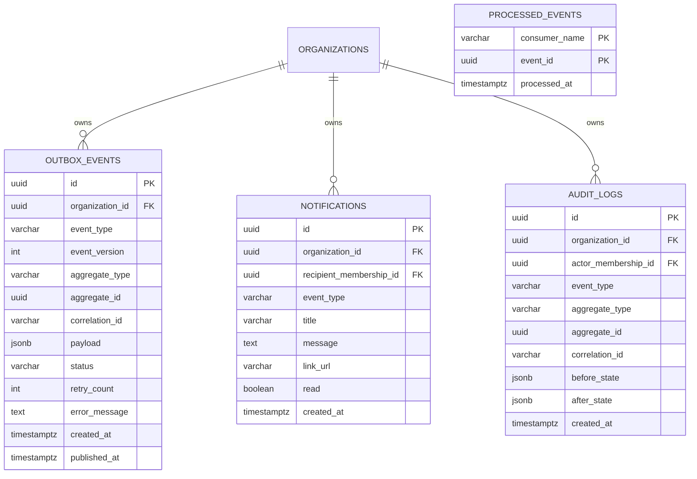

# NexusOps – Transactional Outbox, Events, Notifications & Audit Architecture

**Document Version:** 1.0.0  
**Status:** Approved for Architecture & Implementation  
**Phase:** Phase 9 – Transactional Outbox & Kafka Event Bus  
**Author:** NexusOps Architecture Team  

---

## 1. Architectural Philosophy: The Transactional Outbox Pattern

In distributed systems and enterprise operations platforms, a common failure mode is dual-write inconsistency:
If a system writes a business record to PostgreSQL and then immediately calls Kafka across the network, a broker disconnect, timeout, or JVM restart can cause the business record to be committed while the event is lost. Conversely, if Kafka is called first and the DB commit fails, consumers process an event that never occurred in the database.

NexusOps resolves this by strictly enforcing the **Transactional Outbox Pattern**:
1. When a business mutation occurs (e.g. `requestService.createRequest`), both the business record (`requests`) and the event envelope (`outbox_events`) are inserted in the **exact same ACID database transaction**.
2. If the transaction commits, the outbox record is guaranteed to be durable on disk. If the transaction rolls back, zero outbox records exist.
3. An asynchronous worker (`OutboxRelayPublisher`) polls `PENDING` outbox events with `SELECT ... FOR UPDATE SKIP LOCKED` and publishes them to Kafka.
4. When Kafka acknowledges the produce request (`acks=all`), the outbox record status transitions to `PUBLISHED` with `published_at = clock_timestamp()`.
5. Consumers use the `processed_events` table for idempotent deduplication, ensuring that even under at-least-once network replays, side-effects (notifications and audit records) are processed exactly once.

---

## 2. Entity-Relationship Diagram (Mermaid)



---

## 3. Data Dictionary

### 3.1 `outbox_events`
| Column | Type | Constraints | Description |
| :--- | :--- | :--- | :--- |
| `id` | `UUID` | PRIMARY KEY, DEFAULT `gen_random_uuid()` | Unique event identifier. |
| `organization_id` | `UUID` | NOT NULL, REFERENCES `organizations(id)` ON DELETE CASCADE | Tenant boundary. |
| `event_type` | `VARCHAR(100)` | NOT NULL | Event name (e.g. `REQUEST_SUBMITTED`, `APPROVAL_CREATED`). |
| `event_version` | `INT` | NOT NULL, DEFAULT 1 | Schema version of payload. |
| `aggregate_type` | `VARCHAR(50)` | NOT NULL | Aggregate domain (e.g. `REQUEST`, `APPROVAL`, `TASK`, `WORKFLOW`). |
| `aggregate_id` | `UUID` | NOT NULL | Target entity primary key. |
| `correlation_id` | `VARCHAR(100)` | NULLABLE | Distributed tracing ID from request header. |
| `payload` | `JSONB` | NOT NULL | Event payload snapshot. |
| `status` | `VARCHAR(30)` | NOT NULL, DEFAULT `'PENDING'` | `PENDING`, `PUBLISHED`, `FAILED`. |
| `retry_count` | `INT` | NOT NULL, DEFAULT 0 | Number of relay attempts. |
| `error_message` | `TEXT` | NULLABLE | Diagnostic error log if relay failed. |
| `created_at` | `TIMESTAMPTZ` | NOT NULL, DEFAULT `clock_timestamp()` | Event generation timestamp. |
| `published_at` | `TIMESTAMPTZ` | NULLABLE | Broker acknowledgement timestamp. |

### 3.2 `processed_events`
| Column | Type | Constraints | Description |
| :--- | :--- | :--- | :--- |
| `consumer_name` | `VARCHAR(100)` | NOT NULL, COMPOSITE PK | Consumer group/handler identity. |
| `event_id` | `UUID` | NOT NULL, COMPOSITE PK | Event identifier. |
| `processed_at` | `TIMESTAMPTZ` | NOT NULL, DEFAULT `clock_timestamp()` | Timestamp of successful consumption. |

### 3.3 `notifications`
| Column | Type | Constraints | Description |
| :--- | :--- | :--- | :--- |
| `id` | `UUID` | PRIMARY KEY, DEFAULT `gen_random_uuid()` | Notification ID. |
| `organization_id` | `UUID` | NOT NULL, REFERENCES `organizations(id)` ON DELETE CASCADE | Tenant boundary. |
| `recipient_membership_id` | `UUID` | NOT NULL | Target employee membership. |
| `event_type` | `VARCHAR(100)` | NOT NULL | Triggering event code. |
| `title` | `VARCHAR(255)` | NOT NULL | Human-readable alert summary. |
| `message` | `TEXT` | NOT NULL | Detailed notification body. |
| `link_url` | `VARCHAR(500)` | NULLABLE | Direct deep link into portal (e.g. `/approvals`, `/tasks/1001`). |
| `read` | `BOOLEAN` | NOT NULL, DEFAULT FALSE | Unread status flag. |
| `created_at` | `TIMESTAMPTZ` | NOT NULL, DEFAULT `clock_timestamp()` | Dispatch timestamp. |

### 3.4 `audit_logs`
| Column | Type | Constraints | Description |
| :--- | :--- | :--- | :--- |
| `id` | `UUID` | PRIMARY KEY, DEFAULT `gen_random_uuid()` | Audit entry ID. |
| `organization_id` | `UUID` | NOT NULL, REFERENCES `organizations(id)` ON DELETE CASCADE | Tenant boundary. |
| `actor_membership_id` | `UUID` | NULLABLE | Membership of actor (or NULL if system automated). |
| `event_type` | `VARCHAR(100)` | NOT NULL | Business action code. |
| `aggregate_type` | `VARCHAR(50)` | NOT NULL | Target entity type. |
| `aggregate_id` | `UUID` | NOT NULL | Target entity identifier. |
| `correlation_id` | `VARCHAR(100)` | NULLABLE | Tracing correlation identifier. |
| `before_state` | `JSONB` | NULLABLE | Pre-mutation entity snapshot. |
| `after_state` | `JSONB` | NULLABLE | Post-mutation entity snapshot. |
| `created_at` | `TIMESTAMPTZ` | NOT NULL, DEFAULT `clock_timestamp()` | Immutable audit timestamp. |

---

## 4. Performance Indexes & Concurrency Strategy

1. **High-Speed Outbox Polling:**
   ```sql
   CREATE INDEX idx_outbox_events_pending ON outbox_events(status, created_at ASC)
   WHERE status = 'PENDING';
   ```
2. **Inbox Notification Queries:**
   ```sql
   CREATE INDEX idx_notifications_recipient ON notifications(organization_id, recipient_membership_id, read, created_at DESC);
   ```
3. **Audit Log Trail Lookup:**
   ```sql
   CREATE INDEX idx_audit_logs_org_agg ON audit_logs(organization_id, aggregate_id, created_at DESC);
   CREATE INDEX idx_audit_logs_created_at ON audit_logs(organization_id, created_at DESC);
   ```

---

## 5. Standard Event Envelope Specification

All events transmitted via the outbox and Kafka follow the standard versioned JSON envelope:

```json
{
  "eventId": "3fa85f64-5717-4562-b3fc-2c963f66afa6",
  "eventType": "REQUEST_SUBMITTED",
  "eventVersion": 1,
  "organizationId": "c56a4180-65aa-42ec-a945-5fd21dec0538",
  "aggregateType": "REQUEST",
  "aggregateId": "1b3c67d8-eff4-45f8-8e4f-1c6a7f93ee31",
  "occurredAt": "2026-11-09T14:40:00Z",
  "correlationId": "820105ad-f9c9-44ac-8b12-59fe514f7e69",
  "payload": {
    "requestNumber": "REQ-1001",
    "title": "MacBook Pro 16-inch M3",
    "requesterMembershipId": "98b8b6f1-5fc4-4035-a10a-367fa19b2191",
    "estimatedAmount": 3200.00
  }
}
```

