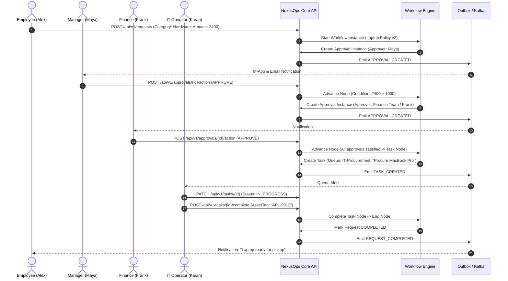

# NexusOps – Product Requirements Document (PRD) & User Stories

**Document Version:** 1.0.0  
**Status:** Approved for Architecture & Design  
**Author:** NexusOps Architecture Team  

---

## 1. Executive Summary & Product Vision

**NexusOps** is an internal operations and service orchestration SaaS platform designed to coordinate, automate, and monitor internal business operations. 

Modern companies often suffer from fragmented internal processes: employees send emails, ping managers on Slack, fill ad-hoc spreadsheets, or navigate siloed ERP/HRMS systems for basic needs (hardware procurement, software licenses, travel reimbursement, access provisioning, employee onboarding).

NexusOps bridges this gap by providing:
1. **Dynamic Request Intake:** Category-driven forms with validated JSON payloads.
2. **Deterministic, Configurable Workflow Engine:** Visual, versioned, graph-based routing without requiring backend code changes.
3. **Multi-Stage Approval Hierarchies:** Role-, department-, and threshold-based approvals with concurrency controls.
4. **Fulfillment Task Queues:** Separation of approval from physical/operational execution.
5. **Nexus AI Operations Assistant:** A strictly governed hybrid AI assistant providing grounded RAG document QA (company policies) and human-in-the-loop tool calling for operational actions.
6. **Multi-Tenant Foundation:** Tenant isolation at API, database (composite FKs + RLS), cache, and vector layers from Day 1.

---

## 2. Core Domain Taxonomy (The Four Inviolable Concepts)

To prevent domain contamination, NexusOps strictly maintains distinct lifecycles and boundaries between four concepts:

```
[Request]  ── triggers ──>  [Workflow Instance]
                                  │
                 ┌────────────────┴────────────────┐
                 ▼                                 ▼
         [Approval Decision]               [Fulfillment Task]
        (Authorized evaluation)           (Operational execution)
                 │                                 │
     Approved?   │                                 │
   ┌─────────────┴─────────────┐                   │
   ▼                           ▼                   │
 [Proceed to Next Node]    [Terminate: REJECTED]   │
   │                      (NO Tasks Ever Created)  │
   │                                               │
   └─────────── All Approvals Finished ────────────┘
                               │
                               ▼
                     [Generate Task Node] ──> Operator Completes ──> [Request COMPLETED]
```

| Concept | Purpose | Mutability / Lifecycle | Example |
| :--- | :--- | :--- | :--- |
| **Request** | Represents an employee's business need and intake data. | `DRAFT` → `SUBMITTED` → `IN_REVIEW` ⇄ `WAITING_FOR_INFORMATION` → `APPROVED` → `IN_PROGRESS` ⇄ `ON_HOLD` → `COMPLETED` (or `REJECTED` / `CANCELLED`) | *"I need a 16-inch MacBook Pro for development work ($2,400)."* |
| **Workflow** | Deterministic directed graph of steps and business routing rules. | Immutable once `PUBLISHED`. Runtime instance executes graph sequentially or branching on typed conditions. | *Step 1: Manager Approval → Step 2: If amount > $1,000, Finance Approval → Step 3: Procurement Task.* |
| **Approval** | Authoritative gatekeeper evaluation by a designated authority. | `PENDING` → `APPROVED` \| `REJECTED` \| `REQUESTED_INFO` \| `EXPIRED` \| `CANCELLED`. Immutable decision records (`approval_actions`). | *Priya (Engineering Manager) reviews specifications and clicks "Approve".* |
| **Task** | Concrete work assigned to an individual operator or functional queue. | `OPEN` → `IN_PROGRESS` ⇄ `BLOCKED` → `COMPLETED` (or `CANCELLED`). Tasks are **never** created on rejection. | *Karan (IT Procurement) orders the laptop from vendor, records serial number, and marks completed.* |

> [!IMPORTANT]
> **Approved ≠ Completed.** An approval is simply an authorization. Work only completes when the assigned fulfillment task is executed. Rejection immediately terminates the workflow instance with status `REJECTED`; **no task is ever generated for a rejected request.**

---

## 3. Actor Personas & Role Matrix

| Persona / Role | Scope | Key Capabilities |
| :--- | :--- | :--- |
| **Employee (Requester)** | Self & Department | Submits requests, tracks timeline, uploads attachments, responds to clarification requests, chats with Nexus AI for policy guidance. |
| **Manager (Approver)** | Direct & Indirect Reports | Reviews direct reports' submissions, approves/rejects/requests info, delegates approvals during leave. |
| **Operator (IT / Procurement / HR / Finance)** | Functional Queue | Claims tasks from shared department queue, works on fulfillment, comments internally, marks tasks completed/blocked. |
| **Department Head (Executive Approver)** | Entire Department | High-value approval escalation (> $50,000 threshold), department operational reports. |
| **Organization Admin** | Entire Organization | Manages users, roles, departments, teams, request categories, workflow designer (draft/publish), SLA settings, audits. |
| **Executive** | Entire Organization | High-level KPI dashboards, SLA compliance metrics, cost bottleneck heatmaps, AI operational summaries. |
| **Platform Admin** | Cross-Organization (System) | Tenant provisioning, organization activation/suspension, global platform maintenance. Cannot be assigned by Org Admins. |

---

## 4. End-to-End Reference User Journey: Hardware Purchase

### Scenario
Alex (Software Engineer) requires a new developer workstation costing \$2,400.
Company Policy Rules:
- Amount < $1,000: Direct Manager approval only.
- $1,000 - $10,000: Direct Manager approval + Finance approval.
- > $10,000: Direct Manager + Finance + Department Head approval.
- Post-approval: Dispatches fulfillment task to IT Procurement queue.



---

## 5. Detailed Role-Based User Stories & Acceptance Criteria

### Epics Overview
- **EPIC-01:** Identity, Multi-Tenancy & Access Governance
- **EPIC-02:** Dynamic Request Intake & Lifecycle Management
- **EPIC-03:** Configurable Workflow Engine & Visual Graph Orchestration
- **EPIC-04:** Multi-Stage Approval Inbox & Escalation
- **EPIC-05:** Operational Task Fulfillment & Queue Management
- **EPIC-06:** Grounded Knowledge Base & Tenant-Scoped RAG
- **EPIC-07:** Nexus AI Assistant (Action Tools & Natural Language Ops)
- **EPIC-08:** Operational Analytics, Audit & Compliance

---

### Epic 1: Identity, Multi-Tenancy & Access Governance

#### US-1.1: Multi-Tenant Organization Registration
- **As an** prospective customer or platform administrator,  
- **I want to** register an organization with a unique slug and admin credentials,  
- **So that** my company can operate in complete isolation from all other tenants.
- **Acceptance Criteria:**
  - `POST /api/v1/auth/register-org` creates both a global `User` and an `Organization`, linking them via `OrganizationMembership` with the system role `ORG_ADMIN`.
  - Default roles (`ORG_ADMIN`, `MANAGER`, `EMPLOYEE`, `OPERATOR`) and system permissions are automatically seeded for the new organization.
  - Organization slug must be unique and URL-safe.
  - Direct database queries confirm `organization_id` is populated across all seeded organizational data.

#### US-1.2: Multi-Organization Membership Switching
- **As a** contractor or consultant working across two distinct companies,  
- **I want to** use a single global login and switch between my active organizations,  
- **So that** I don't have to manage multiple logins or risk data bleeding between companies.
- **Acceptance Criteria:**
  - Login returns a short-lived access JWT containing `user_id` and the default `organization_id`.
  - Endpoint `POST /api/v1/auth/switch-org` validates membership in the target organization and issues a fresh JWT with the new `organization_id` claim.
  - All subsequent backend queries enforce the active `organization_id` strictly from the verified JWT.

---

### Epic 2: Dynamic Request Intake & Lifecycle Management

#### US-2.1: Dynamic Schema-Driven Request Submission
- **As an** employee,  
- **I want to** select a request category (e.g., Software Access) and fill in the required dynamic fields,  
- **So that** my request includes all mandatory information required for evaluation.
- **Acceptance Criteria:**
  - Category provides a versioned `payload_schema` JSONB (JSON Schema format).
  - Backend validates the incoming `payload` JSONB against the category schema before accepting the request.
  - Generates a tenant-scoped human-readable `request_number` (e.g., `REQ-1042`).
  - Request is created in `SUBMITTED` state, and the active published workflow for that category is triggered in the same database transaction.
  - Client can pass an `Idempotency-Key` header; repeated submissions return the existing request without duplicate workflow execution.

#### US-2.2: Internal vs Requester-Visible Comments
- **As an** IT operator or manager,  
- **I want to** post internal comments on a request that are invisible to the requester,  
- **So that** our operations team can discuss budget constraints or technical concerns privately.
- **Acceptance Criteria:**
  - `request_comments` table has a `visibility` column: `REQUESTER_VISIBLE` vs `INTERNAL`.
  - When an Employee queries comments for their own request, `INTERNAL` comments are stripped by the service layer.
  - Only users with `REQUEST_VIEW_INTERNAL_COMMENTS` permission can view or create internal comments.

---

### Epic 3: Configurable Workflow Engine

#### US-3.1: Visual Graph Workflow Modeling
- **As an** organization administrator,  
- **I want to** visually configure approval stages, conditions, and fulfillment tasks using a node graph,  
- **So that** I can adapt company processes without writing code or deploying software.
- **Acceptance Criteria:**
  - Workflows consist of nodes (`START`, `APPROVAL`, `CONDITION`, `TASK`, `END`) and directed transitions.
  - Transitions hold typed JSON condition expressions (e.g., `field`, `operator`, `value`).
  - Graph validation enforces: exactly 1 `START` node, at least 1 reachable `END` node, no dangling nodes, no unreachable loops without termination.
  - Publishing creates an immutable `WorkflowVersion`; existing in-flight workflow instances continue executing against the version they were started with.

#### US-3.2: Safe Condition Evaluation
- **As an** organization administrator configuring routing rules,  
- **I want** conditions to evaluate request payload values safely,  
- **So that** dynamic routing works reliably without introducing security vulnerabilities like code injection.
- **Acceptance Criteria:**
  - Condition evaluator only accepts strict, typed JSON predicates.
  - Supported operators: `EQUALS`, `NOT_EQUALS`, `GREATER_THAN`, `GREATER_THAN_OR_EQUAL`, `LESS_THAN`, `LESS_THAN_OR_EQUAL`, `IN`, `CONTAINS`.
  - Field paths are restricted to safe whitelisted roots (`payload.*`, `requester.*`).
  - Never executes JavaScript, SpEL, SQL, or arbitrary scripts.

---

### Epic 4: Multi-Stage Approval Inbox & Escalation

#### US-4.1: Manager & Finance Approval Execution
- **As an** approver (Manager or Finance Lead),  
- **I want to** see pending approvals assigned to me, inspect the request details, and render a decision,  
- **So that** requests move forward promptly.
- **Acceptance Criteria:**
  - Approver inbox lists only approvals where the user is an explicit assignee, manager, or member of the assigned approval role/group.
  - Allowed actions: `APPROVE`, `REJECT`, `REQUEST_INFORMATION`, `DELEGATE`.
  - Every decision writes an immutable `approval_action` record with timestamp, actor, decision, and comments.
  - Concurrency test: Two approvers approving simultaneously must result in one succeeding and the other receiving HTTP 409 Conflict via Hibernate optimistic locking (`@Version`).

#### US-4.2: Request for Information Loop
- **As an** approver needing more details,  
- **I want to** request clarification from the employee,  
- **So that** I do not have to reject the request outright.
- **Acceptance Criteria:**
  - Taking `REQUEST_INFORMATION` action transitions the approval to `REQUESTED_INFO` and the parent request to `WAITING_FOR_INFORMATION`.
  - The employee receives an in-app and email alert.
  - Once the employee submits the clarification comment/attachment, the request returns to `IN_REVIEW` and the approval reactivates to `PENDING`.

---

### Epic 5: Operational Task Fulfillment

#### US-5.1: Task Dispatching & Queue Claiming
- **As an** IT or procurement operator,  
- **I want to** view unassigned fulfillment tasks in my department queue and claim them,  
- **So that** our team can balance operational workload efficiently.
- **Acceptance Criteria:**
  - Fulfillment tasks are created only upon successful completion of preceding approval nodes.
  - Operators can filter by `ASSIGNED_TO_ME`, `UNASSIGNED_IN_MY_TEAM`, and priority.
  - Claiming a task sets `assignee_membership_id` and transitions status from `OPEN` to `IN_PROGRESS`.
  - Task completion records operational metadata (e.g., vendor invoice number, serial number).
  - Once all mandatory tasks in the workflow complete, the workflow instance transitions to `COMPLETED` and the request marks `COMPLETED`.

---

### Epic 6: Grounded Knowledge Base & Tenant-Scoped RAG

#### US-6.1: Document Ingestion & Chunking
- **As an** organization administrator,  
- **I want to** upload company policy documents (PDF, Markdown, DOCX),  
- **So that** Nexus AI can answer employee questions accurately according to our internal rules.
- **Acceptance Criteria:**
  - Files are stored in MinIO under tenant-prefixed keys (`{organizationId}/documents/{docId}/{filename}`).
  - Backend asynchronously extracts text via Apache Tika/PDFBox, chunks text (500 tokens with 50-token overlap), generates embeddings, and inserts into `document_chunks` table with `VECTOR` embeddings.
  - Status updates: `UPLOADED` → `PROCESSING` → `INDEXED` (or `FAILED` with error details).

#### US-6.2: Tenant-Isolated Vector Retrieval
- **As an** employee asking policy questions in Company A,  
- **I want** AI answers to be grounded strictly in Company A's documentation,  
- **So that** proprietary policies from Company B are never accessed or leaked.
- **Acceptance Criteria:**
  - Every pgvector similarity query includes a strict SQL filter: `WHERE organization_id = :currentTenantId`.
  - If no relevant chunks exceed the similarity threshold (0.7), the system outputs: *"I could not find an answer in your organization's policy documents. Please contact HR or IT directly."*
  - Responses provide verifiable citations referencing document title and page/chunk index.

---

### Epic 7: Nexus AI Operations Assistant

#### US-7.1: Natural Language Operational Queries
- **As an** employee or manager,  
- **I want to** ask Nexus AI: *"What requests do I currently have waiting for review?"*  
- **So that** I can get instant status updates conversationally.
- **Acceptance Criteria:**
  - AI Orchestrator classifies user intent: RAG query vs Tool Execution vs General Chat.
  - Tool calling invokes pre-registered Java application services (e.g., `searchMyRequests`).
  - Tool derives tenant ID and user ID directly from `SecurityContextHolder`, ignoring any IDs in the LLM prompt.
  - Results are rendered with interactive preview cards.

#### US-7.2: Two-Phase Action Proposal & Confirmation Flow
- **As an** employee asking Nexus AI to create a purchase request,  
- **I want to** inspect a structured preview card and confirm the details before anything is created,  
- **So that** AI cannot perform unintended or unauthorized write actions autonomously.
- **Acceptance Criteria:**
  - Any mutating action (Create Request, Approve, Reassign) executes in `PROPOSED` status.
  - The API returns an action preview object with an expiration window (15 minutes).
  - The UI displays an interactive Proposal Card with "Confirm" and "Cancel" buttons.
  - Execution occurs only when the user clicks Confirm (`POST /api/v1/ai/actions/{actionId}/confirm`).
  - If the user's permissions do not allow the action, the backend rejects the confirmation with HTTP 403.

---

### Epic 8: Operational Analytics, Audit & Compliance

#### US-8.1: Append-Only Immutable Audit Trail
- **As a** compliance officer or organization administrator,  
- **I want to** inspect the complete chronological audit log for any request or user,  
- **So that** all system actions are fully accountable and tamper-evident.
- **Acceptance Criteria:**
  - `audit_logs` records: `actor_membership_id`, `organization_id`, `action`, `resource_type`, `resource_id`, `before_state` JSONB, `after_state` JSONB, `ip_address`, `correlation_id`, `created_at`.
  - Application database role does not grant `UPDATE` or `DELETE` on the `audit_logs` table.
  - Sensitive information (passwords, JWTs, credit card numbers) is scrubbed before writing.

#### US-8.2: Operational KPI & Bottleneck Dashboard
- **As an** executive or department manager,  
- **I want to** see operational metrics like average approval turnaround time, SLA breaches, and task completion velocity,  
- **So that** I can identify bottlenecks and optimize internal processes.
- **Acceptance Criteria:**
  - Dashboard queries calculate: total requests by category/status, average time spent in `PENDING` approval by department, overdue fulfillment tasks.
  - All aggregation queries run using optimized indexes on `organization_id`, `status`, and `created_at`.
  - AI summary tool translates the aggregated statistics into an executive brief without running direct SQL.

